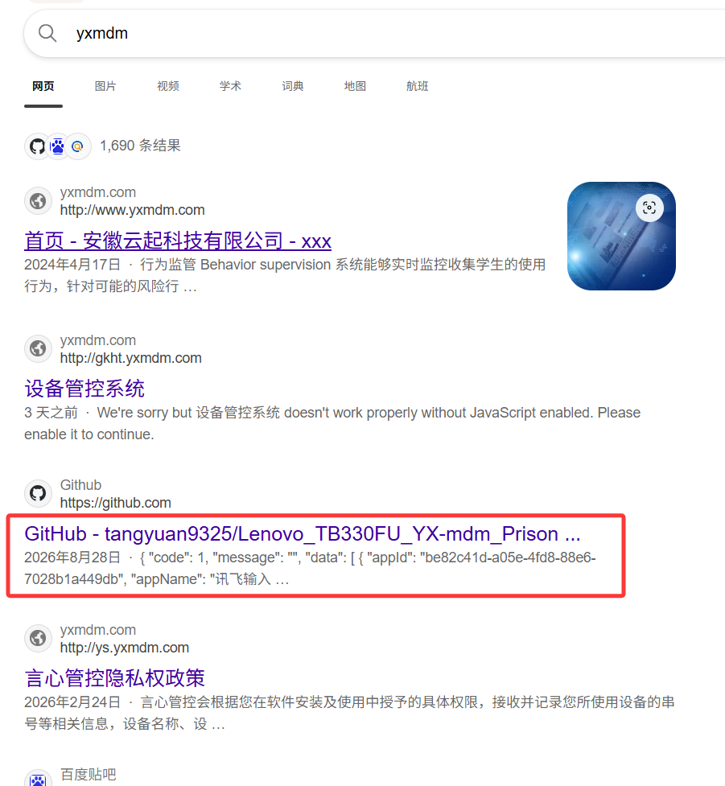

### YX-MDM破解原理
## 免责声明
- 本文及文中所述技术内容（包括但不限于对相关应用程序安全机制、管控策略、逆向分析、漏洞验证、技术原理说明等）仅用于网络安全技术研究、学术交流、学习测试等合法目的，不涉及任何商业用途或商业行为。

- 本文作者及发布平台严禁将本文内容用于任何非法活动，包括但不限于：

    - 1. 未经授权侵入他人计算机信息系统、网络设备或应用程序；

    - 2. 绕过、破坏、删除或规避技术保护措施；

    - 3. 侵害他人知识产权、商业秘密、个人隐私或其他合法权益；

    - 4. 制作、传播破坏性程序或实施其他违反法律法规的行为。

- 任何读者在参考、使用本文内容前，应确保自己拥有合法授权或处于合法测试环境，并严格遵守所在国家或地区现行法律法规。因读者不当使用本文内容所产生的一切法律责任与后果，均由使用者本人自行承担，与作者及发布平台无关。

## 主要原理

- 首先：yx-mdm有这严格的管控模式
  - 1. 限制用户访问某些功能或应用
  - 2. 限制用户在设备上安装某些应用
  - 3. 限制用户在设备上进行某些操作
  - 4. 限制用户在设备上进行某些数据操作
  - 5. 限制用户在设备上进行某些网络操作
  - 6. 开机自启动以及自检查以及行为上报机制
  - 7. 拥有特定的定制系统
    - hemaaixue_TB330FU_2026...
  - 8. 等等

## 因此，我们不能通过寻常的手段解决ta

### 方法一：刷机

但是，这个板子拦截了进入OME的入口（等等，这个竟然是联想的官方设置？？？！！！）

所以，普通的刷机解决不了问题的

我们要请出我们的底牌：MTK模式

[什么是MTK](https://baike.baidu.com/item/%E8%81%94%E5%8F%91%E7%A7%91/6370327)

- 首先我们需要获取到原生的线刷包
  - [点击这里下载](https://www.kdocs.cn/l/cndiYFdYTlfq)
  - 主播这里选用的是TB330FU_CN_OPEN_USER_V15.155_U_ZUI_16.0.068_ST_241112.7z
  - 这个包是MTK模式的线刷包
- 双击运行**运行我，刷机**，等一会就好了

## 问题是小鹿爱学app怎么办呢？（**千万不要在没有小鹿爱学的情况下刷机**）

*小鹿爱学安装包位于QQ群中awa*

- 主播在之前研究时发现了**言心管控**的运行日志

  - 里面有着具体的发包内容以及回应内容
  - 文件目录：**/内部存储/yx** 文件夹下
  - 寻找应用商店的日志
    - 应该在 **/appstore** 目录下
  - 找到后会看到如下日志：
    ```txt
      ┌────── Request ──────────
      │ URL:
      │
      │ Method:
      │
      │ Headers:
      │
      │ Body:
      │       ........
      │
      └──────────────────────────
      ┌────── Response ──────────
      │ Status Code:
      │
      │ Headers:
      │
      │ Body:
      │       ........
      │
      └──────────────────────────
    ```
  - 通过分析日志，我们可以发现言心管控的运行日志中包含了应用商店的发包内容以及回应内容
  - 我们可以通过发包来获取最新应用列表
  - (*以下省略发包部分，具体应用可选用reqable*)
  - 返回内容如下：
    ```json
    {
      "code": 1,
      "message": "",
      "data": [
        {
          "appId": "be82c41d-a05e-4fd8-88e6-7028b1a449db",
          "appName": "讯飞输入法",
          "packageName": "com.iflytek.inputmethod",
          "categoryName": "工具类",
          "appType": 4,
          "appLogo": "http://oss.yxmdm.com/icons/com.iflytek.inputmethod_af082f29-e/app_high_icon.png",
          "isRecommend": 0,
          "isDyncAuth": 1,
          "appAttr": 1,
          "forceUpdate": 1,
          "urlAuth": 0,
          "isTimeUpdate": 0,
          "timeUpdate": null,
          "isTimeUnload": 0,
          "timeUnload": null,
          "appStatus": 1,
          "sortIndex": 2999,
          "description": "",
          "versionName": "8.0.6442",
          "versionNo": 64414,
          "versionSize": 17932017.0,
          "filePath": "http://47.99.242.59/讯飞输入法教育版.apk",
          "versionType": null,
          "useTimeRule": "111111111111111111111111111111111111111111111111111111111111111111111111111111111111111111111111111111111111111111111111111111111111111111111111111111111111111111111111"
        }
      ],
      "success": true
    }
    ```
- 这样，我们就可以拿到小鹿爱学的安装包了

## 哎？这时候有人就问了：主播主播，刷机过后也太太太明显了吧

那么就不得不编造一下一种已经实现过然后被修的方法了喵~

**代理·中间人**

意思很好理解，就是嘛通过拦截流量啥的改包

*问题是这个东西由于我们班同学的不当使用*

~~然后被修了~~

~~悲痛万分~~

**哎，问题来了，ta具体怎么修的呢？**

- 往Applist请求改为了ApplistV2
  - ~~然后加了一层密~~

~~呵呵~~

## 友情提醒，更多内容请前往QQ获取awa

没有别的，因为高强度自搜搜到本仓库了awa



## QQ群：[996502537](https://qm.qq.com/q/Tdx0D94Bsk)

## 附：老师来检查了怎么办

参考：https://github.com/tangyuan9325/teacher-is-here

- 这是一个自研的锁定应用的app
- 还有很多漏洞
*请斟酌后安装*
